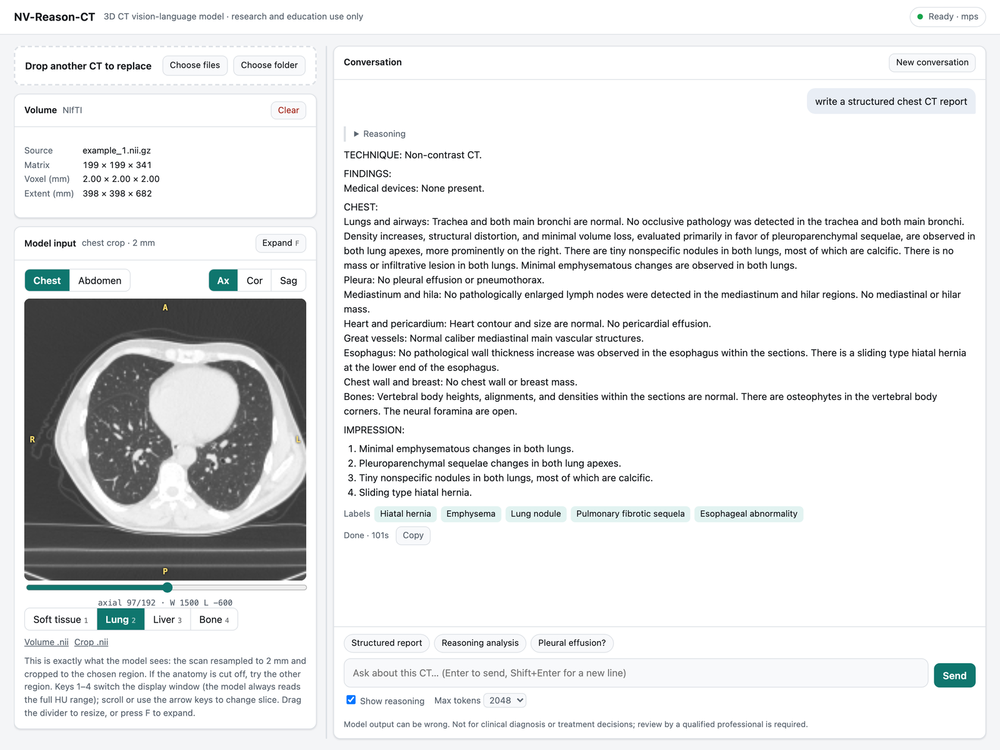

# NV-Reason-CT Reader

**Drag a chest or abdominal CT into your browser, see exactly what the AI is looking at, and ask it questions, all on your own computer.**



NVIDIA's [NV-Reason-CT](https://huggingface.co/nvidia/NV-Reason-CT) is an AI
model that reads a whole CT volume at once. It can write a structured report,
walk through its reasoning step by step, or answer a direct question such as
"Is there a pleural effusion?". NVIDIA released it as code for programmers.
This project puts it behind a simple page that a radiologist, trainee or
researcher can use without writing any code.

> **For research and teaching only.** This is not a medical device. The model
> can miss findings and can describe findings that are not there. Do not use
> it for diagnosis or treatment decisions.

## What it does

- **Opens the scans you already have.** Drag in a DICOM folder or `.zip` from
  a PACS export, or a NIfTI (`.nii`) file. A stack of JPEG or PNG slices also
  works as a last resort.
- **Shows you what the AI sees.** Before you ask anything, scroll through the
  exact 38 cm cube the model will read, in axial, coronal and sagittal views.
  Press **O** to switch to the **original** full-resolution scan, with the
  model's cube outlined. Keys **1–4** switch between soft tissue, lung, liver
  and bone windows, and **F** enlarges the image.
- **Measures.** Hover to read Hounsfield units, draw a **ruler** (R) for
  distances, or draw an **oval ROI** (E) for mean, SD, min/max and area. On
  the original scan, measurements use its full resolution; on the 2 mm model
  input they are approximate. Use your PACS for clinical measurements.
- **Exports a case summary.** One click saves a single file named after the
  study, with key images, measurements and the whole conversation. It opens in
  any browser and prints to PDF.
- **Answers questions.** Ask for a structured report, a reasoning walk-through
  or a yes/no question, then follow up. The model is NVIDIA's original,
  unmodified, and it reads the whole scan again for every question.
- **Keeps scans private.** Everything runs on the computer you start it on.
  Nothing is uploaded.

## What you need

- A Mac with Apple silicon and **32 GB of memory** (tested on an M2 Max), or a
  Linux computer with an NVIDIA graphics card with 24 GB or more. Windows has
  not been tested.
- About 15 GB of free disk space. The AI model alone is 10.6 GB and downloads
  the first time you start the reader.
- Patience. On the M2 Max, each answer starts after 30–60 seconds while the
  model reads the scan, and a full report takes one to two minutes.

## Set it up on a Mac (one time)

1. Install [Miniforge](https://github.com/conda-forge/miniforge), a free
   Python installer. Download the macOS arm64 version and follow its
   instructions.
2. Download this project: click the green **Code** button at the top of this
   page, choose **Download ZIP**, and unzip it. (You can also clone it with
   GitHub Desktop.)
3. Open **Terminal**. Type `cd` followed by a space, drag the unzipped
   `NV-Reason-CT` folder onto the Terminal window, and press Return. Then
   paste these two commands one at a time. The second takes a few minutes.

   ```bash
   conda create -y -n nvreasonct python=3.11
   ```

   ```bash
   conda run -n nvreasonct python -m pip install -r requirements.txt -r webapp/requirements.txt
   ```

## Use it

1. In the `webapp` folder, double-click **`start_mac.command`**. A Terminal
   window opens; leave it open while you work. Your browser then opens the
   reader. The first time, the AI model downloads before the page says
   **Ready**.
2. Drop in a scan, choose **Chest** or **Abdomen**, and check the image.
3. Click a suggested question or type your own.
4. When you're done, close the Terminal window to stop the reader.

If macOS won't open `start_mac.command` because it comes from an unidentified
developer, open **System Settings › Privacy & Security** and click
**Open Anyway**.

## Tips for good results

- **Use DICOM or NIfTI whenever you can.** JPEGs lose the Hounsfield units the
  model relies on. A soft-tissue-window JPEG, for example, makes normal lung
  look solid to the model.
- **Check the crop before you ask.** If the organ you're asking about is cut
  off in the viewer, the model can't see it either. Try the other region.
- **Small findings can be missed.** The model looks at the scan at 2 mm
  resolution, so findings of a few millimetres may not register.
- **Turn off "Show reasoning"** for short, direct answers.

## How it works

The reader turns your files into a single 3D volume and trims it to a 38 cm
cube around the chest or abdomen, using NVIDIA's own preprocessing code. It
then gives that cube and your question to the model and shows the answer as
it is written. It uses NVIDIA's original model weights. For technical
details, settings, and the programming interface, see
[webapp/README.md](webapp/README.md).

## Credits and license

- The AI model, its training and the original research code are by NVIDIA
  and its collaborators: [model card](https://huggingface.co/nvidia/NV-Reason-CT),
  [paper](https://arxiv.org/abs/2609.27511), and
  [original repository](https://github.com/NVIDIA-Medtech/NV-Reason-CT).
  NVIDIA's original README, including its training instructions, is kept in
  [NVIDIA_README.md](NVIDIA_README.md).
- This project adds the reader in the [`webapp`](webapp) folder, released
  under the MIT License (see [webapp/LICENSE](webapp/LICENSE)).
- NVIDIA's model and code are licensed under the OpenMDW License 1.1 (see
  [LICENSE](LICENSE)). Third-party packages are listed in
  [THIRD-PARTY-NOTICES](THIRD-PARTY-NOTICES).
